# Michael

  
  

- 👋 Hi, I’m Michael
- 👀 I’m interested in embodied AI and computer science.
- 🌱 I’m currently learning , C, C++ and Python.
- 🤖 Maxim: There's no need to fear about infinite knowledge, every progress is worth cherishing and rejoicing in.

## Tech Stack

)  

<!---
RoyalRookie88/RoyalRookie88 is a ✨ special ✨ repository because its `README.md` (this file) appears on your GitHub profile.
You can click the Preview link to take a look at your changes.
--->
